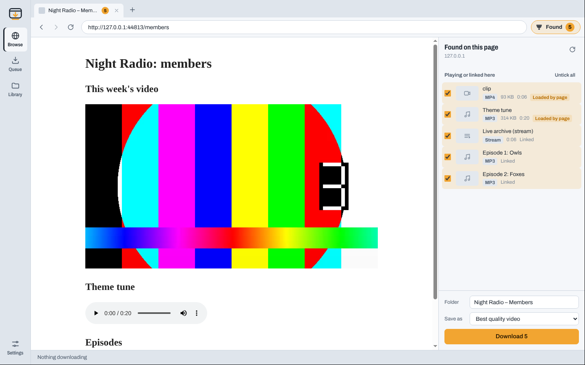
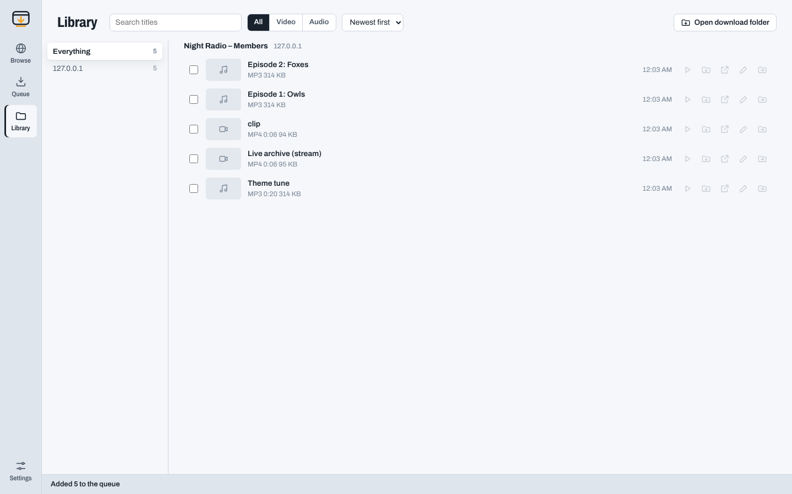

# browseDL

A web browser that catches the audio and video on every page you visit. Log in to a site right inside browseDL, open a page, and everything playable on it is listed in the **Found** panel. Tick what you want, press **Download**, and it all goes through one queue into neatly organised folders.

It's the bigger sibling of [groupDL](https://github.com/terpenesalad/groupDL): same engine (yt-dlp and ffmpeg), but it works on any site, including ones you have to log in to.



## Download

Get the file for your computer from the [latest release](https://github.com/terpenesalad/browseDL/releases/latest):

| Computer | File |
| --- | --- |
| Windows 10/11 | `browseDL-windows-setup.exe` (installs it) or `browseDL-windows-portable.exe` (runs without installing) |
| Mac with Apple silicon (M1 or newer) | `browseDL-macos-arm64.dmg` |
| Linux (x86-64) | `browseDL-linux.AppImage` |

Everything browseDL needs (yt-dlp, ffmpeg and Deno) is built in, so there's nothing else to install.

**Windows:** run the setup file. If SmartScreen warns about an unrecognised app, click *More info* then *Run anyway*.

**Mac:** open the `.dmg` and drag browseDL into Applications. The app isn't signed by Apple, so before the first launch open Terminal and run:

```sh
xattr -cr /Applications/browseDL.app
```

After that it opens normally.

**Linux:** `chmod +x browseDL-linux.AppImage && ./browseDL-linux.AppImage`. On Ubuntu 24.04 and newer, if it doesn't open, add `--no-sandbox`.

## Using it

### Browse and log in

browseDL has its own browser with tabs. Log in to sites the way you normally would; browseDL remembers your logins between sessions and uses them for every download. Pop-up login windows ("Sign in with…") open as their own small window, like in a normal browser.

### The Found panel

As a page loads, browseDL lists everything it can save:

- **Whole pages, playlists and channels** on the 1,800+ sites yt-dlp knows (YouTube, Vimeo, SoundCloud, Bandcamp, TikTok, X, Twitch VODs, Dailymotion, Bilibili, many news and course sites…). A channel's sections, like *Videos* or *Shorts*, show up as lists; click **Show what's in it** to pick from them.
- **Anything that plays on any other site**: video and audio files, and HLS and DASH streams, caught as the page loads them. If something doesn't show up, press play on it.
- **Links to media files** on the page, like a list of podcast episodes or lecture recordings.
- **Linked video pages**: on a listing page (a season, search results, an artist's page), browseDL checks the page's links and lists the ones that lead to videos yt-dlp can download, grouped by kind, e.g. *Linked concert pages (24)*. These start unticked; press **Tick all** to grab the lot without opening each one. A linked page with several videos (a concert with several works, a playlist) is saved into a folder of its own, numbered in order.

Long lists can be narrowed with the **filter box** at the top of the panel: type a conductor, composer, year or anything in the title, e.g. `rattle mahler`. Every word has to match, and accents don't matter (`dvorak` finds *Dvořák*). **Tick all** then ticks just the matches, and ticks from earlier searches are kept, so you can search for one conductor, tick all, then search for another.

Everything else is ticked except things you've already downloaded. Untick what you don't want (**Untick all** / **Tick all** work per section), then choose:

- **Folder**: the collection folder name (starts as the page or playlist title)
- **Save as**: the format
- **Save in**: where on your computer this batch goes. Your default download folder, a folder you've used recently, or **Choose a folder…**

and press **Download**.

You can also right-click any video, audio or media link in a page and choose **Download this video**. When a page starts a download itself (an episode's download button, say), audio and video go straight into the queue, and any other file is saved to a `Files` folder for that site.

### Queue

Up to six downloads run at once (Settings → *Download at the same time*). Each row fills up as it downloads.

- **Pause** keeps what's been downloaded so far; **Resume** carries on from there.
- **Stop** cancels and tidies away the half-finished file. **Stop all** in the bottom bar stops everything at once.
- **Download next** moves a waiting item to the front. **Drop waiting** clears everything that hasn't started.
- **Retry failed** tries everything that failed again. Failures say what went wrong in plain words.
- **Add links**: paste page, playlist, channel or direct media links, one per line, and pick where they're saved.

The queue is saved, so anything unfinished picks up again next time you open browseDL.

### Library



Every download is listed by site and folder. Search, show only video or only audio, and sort by date, name or size. From each item you can play it, show it in its folder, go back to the page it came from, rename it, or move it into another folder. Select several to move them together, remove them from the library, or delete the files (they go to your bin).

### How downloads are organised

By default files are saved as `Downloads/browseDL/<site>/<folder>/<title>` (change the default in Settings, or pick another place per batch with **Save in**), for example `browseDL/youtube.com/Lo-fi mixes/Rainy day [abc123].mp4`. In Settings you can switch to *site only*, *folder only* or *everything in one folder*, and keep audio and video in separate `Audio` and `Video` folders.

**Skip things I already have** (on by default) stops the same video or file being downloaded twice, even from a different page.

### Formats

- **Best quality video**, or video capped at **1080p**, **720p** or **480p** (MP4, falling back to MKV only when the streams can't go in MP4)
- **Audio only** as **MP3**, **M4A**, or the **original format** with no conversion

### Sites that need a login token (Digital Concert Hall)

Some sites don't use cookies for their videos, so yt-dlp needs the site's login token instead. For [Digital Concert Hall](https://www.digitalconcerthall.com/) browseDL reads it from its own browser automatically: just log in there in Browse. Concert pages then list every work, and season, search and artist pages list their linked concerts. If a download says you need to be logged in, open the site in Browse, play something for a moment, and retry.

### When a site won't let you log in here

A few sites (Google sign-in, mostly) refuse embedded browsers. Log in with your normal browser instead, then in Settings set **Logins for downloads** to that browser (Chrome, Firefox, Edge, Brave, Safari and others). On Windows, close that browser before downloading so its logins can be read.

### What it can't download

Streams protected with DRM (Netflix, Disney+, Spotify, Apple Music and similar) can't be saved, and browseDL marks them as such. Only download things you have the right to keep, and respect each site's terms and creators' rights.

## When downloads stop working

Sites change often and yt-dlp keeps up with them. Open **Settings → yt-dlp → Update yt-dlp** to get the newest version without reinstalling browseDL.

## Privacy

browseDL runs entirely on your computer. When it starts a download it hands that download a copy of the built-in browser's cookies in a file only you can read, and deletes it as soon as the download ends. Settings, the queue and the library are kept in browseDL's data folder (`%APPDATA%\browseDL` on Windows, `~/Library/Application Support/browseDL` on Mac, `~/.config/browseDL` on Linux). **Settings → Clear browsing data** logs you out of everything.

## Running from source

Needs Node.js 22 or newer.

```sh
git clone https://github.com/terpenesalad/browseDL
cd browseDL
npm install
npm run fetch-binaries   # downloads yt-dlp, ffmpeg and deno for this computer into vendor/
npm start
```

Without `fetch-binaries`, browseDL uses `yt-dlp`, `ffmpeg` and `deno` from your PATH.

Build an installer for the computer you're on with `npx electron-builder` (output in `dist/`), then check that the built app can download, join and convert with `dist/<platform>-unpacked/browseDL --self-test`.

Tests:

```sh
npm test                          # unit tests
xvfb-run -a node test/e2e.js      # drives the real app through a members-only test site (Linux)
```

## How it works

browseDL is an [Electron](https://www.electronjs.org/) app. Each tab is a Chromium view with a persistent session, so logins stick. browseDL watches that session's network responses for media files and HLS/DASH playlists (reading playlists to hide the individual quality variants and to spot DRM), scans each page for `<video>`, `<audio>` and links to media files, and asks [yt-dlp](https://github.com/yt-dlp/yt-dlp) whether it knows the site. Downloads run through yt-dlp with the session's cookies, the page's referrer and the browser's user agent, with ffmpeg joining picture and sound and converting audio.
